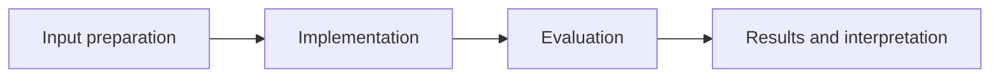

# Navigation with Double DQN

**Feras Elghandour** · Technical case study

Learn a discrete navigation policy from vector observations while reducing overestimation in value learning.

## Implementation

Online action selection and target-network evaluation, experience replay, epsilon-greedy exploration, and soft target updates.



## Evidence and results

The source provides the full agent and a simulation training entry point. CPU checks exercise action selection and parameter updates. A score target in the training script is a stopping criterion, not evidence of an achieved benchmark.

Results described as saved come from the retained experiment record. See [VALIDATION.md](VALIDATION.md) for the checks performed on this release and their scope.

## Practical relevance

This project demonstrates online action selection and target-network evaluation, experience replay, epsilon-greedy exploration, and soft target updates.
The implementation and evaluation make the trade-offs inspectable for technical review.

## Run locally

```sh
python -m venv .venv
source .venv/bin/activate
python -m pip install -r requirements.txt
python Navigation.py
# Full simulation also requires a compatible legacy unityagents installation.
```

Prepare the inputs described in [DATA.md](DATA.md) first. Source validation is available without installing model dependencies:

```sh
python scripts/validate_source.py
```

Run the focused offline behavior checks with `python smoke_test.py` after installing the dependencies.

## Limitations

The legacy Banana Unity environment is needed for full end-to-end reproduction. No environment executable, saved reward curve, or trained checkpoint is bundled; no solved score is fabricated.

## Development

Changes should include a clear description of the behavior affected and verification appropriate to that behavior. Keep input data, credentials, model caches, and generated artifacts outside version control.
