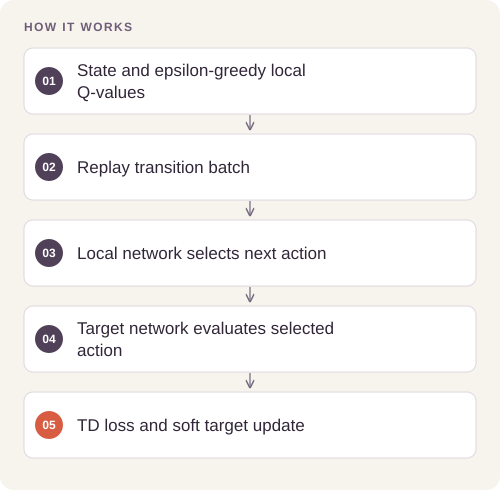

# Navigation with Double DQN

Learn a discrete navigation policy from vector observations while reducing overestimation in value learning.

## Implementation

Online action selection and target-network evaluation, experience replay, epsilon-greedy exploration, and soft target updates.



## Try a small example

Generated transitions exercise action selection and one learning update. This does not establish navigation performance in an environment.

After the local setup below, run from the repository root:

```sh
python examples/quickstart.py
```

The [example source](examples/quickstart.py), [captured output](examples/expected-output.txt) and [execution record](examples/environment.json) keep this demonstration inspectable. Floating-point values may vary with library versions.

Observed output from this run:

```text
{
  "fixture": "untrained Q network/generated transitions; no environment score",
  "action": 3,
  "replay_size": 8,
  "online_changed": true
}
```

## Evidence and results

The source provides the full agent and a simulation training entry point. CPU checks exercise action selection and parameter updates. A score target in the training script is a stopping criterion, not evidence of an achieved benchmark.

See [VALIDATION.md](VALIDATION.md) for the release checks and their scope.

## Run locally

```sh
python -m venv .venv
source .venv/bin/activate
python -m pip install -r requirements.txt
python Navigation.py
# Full simulation also requires a compatible legacy unityagents installation.
```

Prepare the inputs described in [DATA.md](DATA.md) first. Source validation is available without installing model dependencies:

```sh
python scripts/validate_source.py
```

Run the focused offline behavior checks with `python smoke_test.py` after installing the dependencies.

## Limitations

The legacy Banana Unity environment is needed for full end-to-end reproduction. No environment executable, saved reward curve, or trained checkpoint is bundled; no solved score is fabricated.
